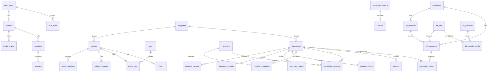

# IndicoRica data dictionary (phase 02)

All tables are in `public`, have **RLS enabled**, and API roles start with **no privileges** (see
`20261108060000_operations_storage_grants.sql`). Helper functions live in the non-exposed `private` schema.

**Roles:** *guest* (anon) · *member* (any signed-in user) · *verified business owner* (row in `business_owners`
with status `verified`) · `contributor` · `editor` · `ad_manager` · `content_admin` · `super_admin`
(rows in `user_roles`). Higher editorial roles include lower ones (super_admin ⊃ content_admin ⊃ editor ⊃ contributor).

## Identity & operations
| Table | Purpose | Guest | Member | Staff |
|---|---|---|---|---|
| `profiles` | one row per auth user; public display name only | – | own | content_admin+ read |
| `profile_private` | phone (consent-based, never public) | – | own only | **nobody via API** |
| `user_roles` | role grants | – | read own | super_admin grants/revokes; every change audited; client cannot set `granted_by` |
| `audit_log` | append-only record of role, business, ad changes | – | – | content_admin+ read; written only by DB triggers |
| `app_settings` | private admin settings | – | – | content_admin+ |
| `app_settings_public` | public site settings (phase 01) | read | read | content_admin+ write |
| `content_correction_requests` | "this is wrong" reports | – | submit/read own | editors resolve |
| `media_assets` | upload metadata (type/size limited) | public buckets | own | per bucket role |

## Editorial (draft → in_review → published; archive/trash reversible)
| Table | Notes |
|---|---|
| `pages`, `site_sections`, `articles`, `faqs`, `events` | status workflow enforced in DB. Contributors create drafts / `in_review` only. Editors publish, archive, trash, restore. Trash records `deleted_at/by`. Hard delete = super_admin only. |
| `article_revisions` | written by trigger on every title/summary/body/status change; staff read only |
| `editorial_sources` | cited sources (HTTPS URL + accessed date) |
| `categories`, `tags`, `article_tags`, `redirects`, `navigation_items` | structure; public read, editors write |

**High-stakes rule:** an article with `is_high_stakes = true` cannot be published unless `review_status = 'reviewed'`,
`last_reviewed_at` is set, and it has ≥ 1 `editorial_sources` row. Only editors can mark reviewed.

## Discovery
| Table | Notes |
|---|---|
| `businesses` | public only when `published`. Owners edit their own; they cannot change status, slug, authorship, demo flag or verification. Verification needs `verification_source`. `is_demo` marks seed data. |
| `business_owners` | members file **pending** claims; only editors verify. Only `verified` rows grant rights. |
| `business_contacts` | phone/WhatsApp/email, **public only when `public_consent` is true** (DB stamps who/when) and the business is published |
| `business_images` | public only when `is_approved` (editors) and business published; path must start with the business id |
| `business_hours` | owner/editor write |
| `ingredients`, `ingredient_suppliers` | grocery finder catalogue |
| `availability_evidence` | **dated** observations. Members' tips are forced to `pending`; guests see `approved` only. Future dates rejected. |

## Community
`questions`, `answers` (moderation: pending → approved/rejected/removed; authors cannot self-approve; edit only while
pending), `moderation_decisions` (append-only), `reports`, `favorites` (own only), `event_submissions` (pending →
editor review), `community_authors` (view: display names of approved authors only), `moderation_queue` (invoker view,
editors only).

## Ads
| Table | Who writes |
|---|---|
| `advertisers`, `ad_slots`, `ad_creatives`, `ad_campaigns`, `sponsored_listings`, `ad_provider_config` | ad_manager / super_admin |
| `ad_providers` (which networks are approved) | **super_admin only** |
| `ad_settings` (global kill switch) | ad_manager / super_admin |

No HTML/JS is stored anywhere: creatives are images + HTTPS links, provider IDs match `^[A-Za-z0-9_/-]{1,64}$`,
targeting is limited to `areas|categories|languages`, the disclosure label is constrained, config can be enabled only for an
approved provider, and guests see campaigns only while approved, in date, creative approved, **and the kill switch is on**.

## Storage buckets
| Bucket | Public | Limits | Write |
|---|---|---|---|
| `business-images` | read | 5 MB, jpeg/png/webp | editors, or verified owner in `<business-id>/` folder |
| `ad-creatives` | read | 2 MB, jpeg/png/webp | ad managers |
| `private-imports` | **no** | 10 MB, csv/json | content_admin+ only |

## Entity relationships

## Operating notes
- **Trusted server code (service role)** is not downgraded by workflow triggers (they apply to `anon`/`authenticated` only).
  The API must still check the caller's role before any privileged write.
- **First super admin:** after signing in once, run in the SQL editor:
  `insert into public.user_roles(user_id, role) values ('<your auth user id>', 'super_admin');`
- **Not yet enforced:** MFA (`aal2`) for privileged roles — added with admin auth in phases 04–05.
- Trash/archive history = status + `deleted_at/by` + `audit_log` for businesses; revisions for articles.
